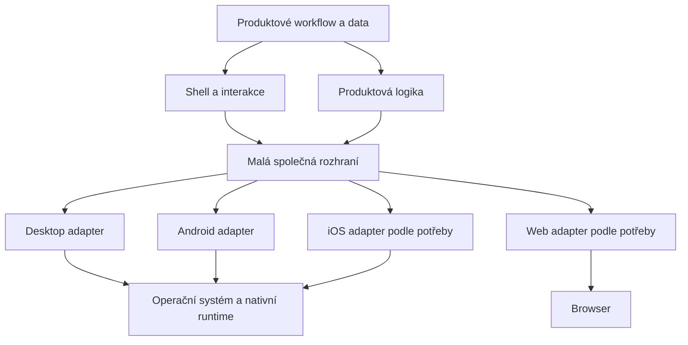

# Plán pro stavbu produkčních aplikací napříč platformami

Verze průvodce 1.2 · 20. listopadu 2026

Tento základ slouží pro návrh nového produktu, vytvoření startovací šablony a pozdější vyčlenění společného frameworku. Vychází z vývoje TRAWLu: desktopového a mobilního rozhraní, nativního runtime, ovládání, správy oken, nastavení, instalačních balíčků a aktualizací. Pravidla lze použít i s jiným stackem.

**Nedílnou součástí je [referenční katalog rozhraní a chování TRAWLu](trawl-interaction-catalog.md).** Obsahuje recepty našich barů, responzivních rozvržení, vratných trackpad gest, Android Predictive Back, mobilního refresh gesta a indikátoru, drawer scroll/drag, přesouvání tabů, tooltipů, hledání, macOS chrome/tray/Dock, Android insets a background/notifikací. Samostatně zaznamenává pohyb plovoucích akcí, konkrétní transitions, keycaps, původ a rozsah nastavení, highlighty, soubory a témata. Zachovává průběh, kalibraci, důvod, přerušení, zdrojový kód i ověřovací scénář. Při stavbě šablony se tyto detaily nesmějí ztratit pouhým převodem na obecné zásady.

Součástí sady je také [plán lokalizace](production-app-localization-plan.md): webové UI, nativní menu, notifikace, live aktivity, plurály, formátování, RTL, offline balíček a ověření. Lokalizace TRAWLu je následná fáze po dalším testování a rozhodnutí o jejím zahájení; současná aplikace tímto dokumentem nové překlady nezískává.

**Doporučené pořadí je průvodce → samostatná šablona → druhá skutečná aplikace → společné knihovny.** Framework má vyčlenit chování, které se opakuje, a ukrýt jeho složitost za malé rozhraní. Nemá předem rozhodovat o všech budoucích produktech.

Produkční připravenost znamená ověřenou cestu uživatele od instalace přes běžnou práci a obnovu po chybě až po aktualizaci. Podpora se deklaruje pro konkrétní kombinaci platformy, architektury, verze systému, zařízení, vstupu a distribučního kanálu. Společný zdrojový kód sám o sobě tuto podporu nedokazuje.

Obsah: [Použití](#jak-průvodce-používat) · [Architektura](#produkt-a-architektura) · [Okno a layout](#okno-a-rozvržení) · [Navigace a vstupy](#navigace-a-ovládání) · [UI a formuláře](#dialogy-formuláře-a-vizuální-základ) · [Lifecycle](#lifecycle-úlohy-a-systémové-integrace) · [Data a bezpečnost](#data-bezpečnost-a-provozní-kvalita) · [Build a release](#build-aktualizace-a-vydání) · [Ověřování](#ověření-produkční-připravenosti) · [Plán šablony](#plán-vytvoření-šablony-a-frameworku) · [Reference](#reference-a-údržba-průvodce).

## Jak průvodce používat

1. Vyplň [specifikaci projektu](production-app-project-brief.md). Vyber cílové platformy, hlavní workflow a první distribuční kanál.
2. Projdi všechny recepty [konkrétního katalogu](trawl-interaction-catalog.md) a v briefu zaznamenej převzetí, přizpůsobení nebo vědomé nepoužití. Například editor potřebuje drafty; jednoduchý prohlížeč dat nemusí potřebovat tray ani background runtime. Neoznačuj potřebné ovládání za nepoužité jen kvůli zjednodušení implementace.
3. Implementuj jednu celou cestu na referenčním zařízení. Pak ji přenes na další deklarované profily a vstupy.
4. Přidej měření, regresní scénáře a ověření skutečného instalačního balíčku.
5. Společný kód odděluj až po ověření ve druhé aplikaci. Produktová pravidla ponech u produktu.

### Mapa konkrétního chování

Tato mapa pomáhá najít i drobné interakce, které se při přenosu snadno ztratí. Podrobný recept obsahuje zdroj, průběh i kontrolu; obecné kapitoly doplňují architekturu a provoz.

| Hledané téma | Kde je zaznamenané |
| --- | --- |
| Desktop, phone, TV, sidebar, horní/spodní bar a responzivní karty | Katalog [L01–L09](trawl-interaction-catalog.md#rozvržení-a-bary). |
| Akce vpravo dole, souběh download queue a New request, posun nad save bar | [L10](trawl-interaction-catalog.md#l10-geometrie-a-animace-akcí-vpravo-dole), včetně rozměrů a enter/leave/move animací. |
| Previous/next page/action a vrstvy, Escape, unsaved guard | [N01–N05](trawl-interaction-catalog.md#historie-a-vrstvy); [G01–G04](trawl-interaction-catalog.md#gesta) pro vratný trackpad a zámek osy. |
| Page refresh, postupné kreslení, rotace, schování a zachování obsahu | [G05–G07](trawl-interaction-catalog.md#g05-mobilní-pull-to-refresh-vlastní-celé-gesto). |
| Scroll/drag draweru, drag tabů a tažení okna | [G08–G11](trawl-interaction-catalog.md#g08-drawer-nejprve-scroll-a-dalším-swipem-drag). |
| Type-to-focus, Find on page, cílený search, command palette | [T01–T03](trawl-interaction-catalog.md#text-hledání-a-tooltipy). |
| Tooltipy, kopírování, smooth scroll a scrollbar | [T04–T07](trawl-interaction-catalog.md#t04-jeden-tooltip-systém-včetně-mobilních-hintů). |
| Výchozí/custom keybinds, recorder, migrace, keycaps a Cmd+Q single/double/hold | [K01–K05](trawl-interaction-catalog.md#zkratky-a-quit). |
| macOS okno, traffic lights, monitory, zavření, tray, Dock a focus | [M01–M04](trawl-interaction-catalog.md#macos-a-desktopový-lifecycle). |
| Android insets/IME/Back, D-pad/TV a oddělený runtime | [A01–A03](trawl-interaction-catalog.md#android-telefon-a-tv), [A06–A07](trawl-interaction-catalog.md#a06-otevřeně-omezený-lokální-runtime). |
| Notifikace, live aktivity, preference, Stop/Restart a lifecycle | [A04–A05](trawl-interaction-catalog.md#a04-běžná-notifikace-a-live-activities-jsou-dvě-prezentace), [A08](trawl-interaction-catalog.md#a08-notifikace-a-live-akce-podle-účelu-a-viditelnosti). |
| Global/app/instance/request scope, dynamic, inherited, custom, reset a precedence | [S01–S04](trawl-interaction-catalog.md#rozsah-původ-a-aplikace-nastavení), [P01–P03](trawl-interaction-catalog.md#opakované-ui-vzory). |
| File/directory inputy, clear/picker, upload a drop | [P04](trawl-interaction-catalog.md#p04-soubor-a-adresář-mají-specializovaný-control), [P13](trawl-interaction-catalog.md#p13-file-drop-upload-a-directory-picker-mají-odlišné-kontrakty); výslovně odlišuje dnešní podporu od návrhu directory dropu. |
| Instance, logy, editor/drafty, výsledky, fronty, resource profily a storage | [P05–P12](trawl-interaction-catalog.md#p05-připojení-s-uchováním-identity-a-soukromých-údajů). |
| Barvy, animace/transitions, highlight/focus/selection a light/dark/system témata | [V01–V05](trawl-interaction-catalog.md#konkrétní-vizuální-základ); light paleta je návrh šablony, dnešní TRAWL používá dark. |
| Buildy, distribuce, updaty, releases a ověřená podpora | [Build a release](#build-aktualizace-a-vydání), [D01–D05](trawl-interaction-catalog.md#build-vydání-a-přenos-do-šablony). |
| Lokalizace ve všech vrstvách a její budoucí implementace v TRAWLu | [Samostatný plán](production-app-localization-plan.md). |

K úplnosti patří také méně viditelná témata: přístupnost a alternativy gest, zánik procesu, obnova draftů, offline/reconnect, souběžné odpovědi, oprávnění, migrace, důvěryhodná distribuce a bezpečné selhání aktualizace. Zaznamenávají je kapitoly [UI](#dialogy-formuláře-a-vizuální-základ), [lifecycle](#lifecycle-úlohy-a-systémové-integrace), [data](#data-bezpečnost-a-provozní-kvalita) a [ověřování](#ověření-produkční-připravenosti). Zahrnutí pravidla do guide samo neprohlašuje všechny jeho platformní scénáře za již otestované.

V textu platí tři druhy rozhodnutí:

| Druh | Význam | Příklad |
| --- | --- | --- |
| Základní pravidlo | Platí pro aplikace, které danou funkci poskytují. | Změna stránky nesmí bez rozhodnutí uživatele zahodit neuložený dokument. |
| Výchozí vzor | Osvědčená volba z TRAWLu, kterou lze nahradit. | Postranní navigace na desktopu a spodní navigace na telefonu. |
| Pravidlo platformy | Závisí na systému, verzi a distribučním kanálu. | Povolený způsob práce na pozadí a instalace aktualizace. |

Výchozí vzor není systémový standard. Počet položek navigace, zvýšené centrální CTA, tmavý vzhled, zelený akcent, 128 kroků historie nebo dlouhý stisk Quit jsou produktová rozhodnutí, nikoli povinnosti každé aplikace.

## Produkt a architektura

### Rozsah podpory

Před implementací vytvoř matici podpory. Každý řádek má konkrétního vlastníka, distribuční kanál a scénář ověření.

| Profil | Rozvržení a vstup | Co navíc ověřit |
| --- | --- | --- |
| macOS desktop | Myš, trackpad, klávesnice, více displejů. | Menu, Cmd zkratky, traffic lights, fullscreen, Dock, tray a návrat okna. |
| Windows desktop | Myš, klávesnice, někdy dotyk. | Systémové ovládání okna, Snap, různé DPI, instalátor a WebView2. |
| Linux desktop | Myš, klávesnice, odlišná prostředí. | Vybrané distribuce, Wayland/X11, systémové knihovny, tray a file dialogy. |
| Android telefon | Dotyk, systémové Back, softwarová klávesnice. | Insets, rotace, ztráta procesu, oprávnění, notifikace a battery policy. |
| Android tablet a foldable | Dotyk i připojená klávesnice/myš. | Změna dostupného prostoru za běhu, multiwindow, přechod mezi panely. |
| iPhone a iPad | Dotyk, VoiceOver, případně klávesnice/trackpad. | Nativní lifecycle, safe areas, background model a distribuční pravidla. |
| Android TV | D-pad a Select/Back, případně klávesnice. | Souvislý focus, čitelnost z dálky, dosažitelnost akcí bez dotyku. |
| Web a PWA | Browser, jeho historie a bezpečnostní model. | URL, reload, offline stav, aktualizace cache a chybějící nativní funkce. |

iOS/iPadOS a web/PWA jsou zde cíle pro budoucí šablonu; jejich hotovou implementaci tento průvodce neodvozuje z TRAWLu. Další platformu, například tvOS nebo watchOS, přidej až s konkrétním adapterem, nástroji a ověřením. Android TV podpora nic nedokazuje o tvOS.

Každou podporovanou kombinaci označ jedním stavem: plánováno, sestaveno, integračně ověřeno, ověřeno na zařízení. Záznam musí uvádět verzi nebo commit a identitu balíčku. Starší úspěšné CI se automaticky nevztahuje na novější změny.

### Tři nezávislé osy

**Schopnosti runtime** určují dostupné operace. **Dostupný prostor** určuje rozvržení. **Aktuální vstup** určuje ovládání. Jejich směšování vytváří chyby: prázdné kategorie nastavení na Androidu, dotykové chování v úzkém desktopovém okně nebo zbytečně omezený mobilní klient vzdáleného serveru.

Schopnosti vrací runtime nebo server: například čtení nastavení, editace, výběr adresáře, background úloha, lokální export. Rozlišuj nepodporovanou funkci, nepřidělené oprávnění, dočasnou nedostupnost a čekající načtení. Neznámý stav při startu nesmí krátce vystavit privilegované akce.

Rozvržení vychází z aktuální velikosti pracovní plochy, ne pouze z názvu zařízení. Vstup se může měnit: dotykový notebook používá myš, tablet klávesnici a telefon čtečku obrazovky. User agent použij jen jako pomocný údaj; konkrétní televizní režim je vhodnější získat z nativního prostředí.

### Vrstvy a jejich odpovědnosti

Referenční stack je Bun, TypeScript, Nuxt/Vue, Nuxt UI a Tauri s Rustem; Kotlin nebo Swift řeší specifické nativní chování. Webové UI a nativní runtime mají oddělené odpovědnosti. UI zobrazuje stav a zadává povolené operace, runtime vlastní soubory, oprávnění a práci, která má přežít UI.

Pro referenční Nuxt/Tauri šablonu sestav frontend jako lokální statická aktiva. Produkční nativní balíček nepotřebuje běžící Nuxt dev server; vývojová URL a produkční assets jsou různé konfigurace. Pokud webová varianta potřebuje SSR nebo backend, deklaruj jejich samostatný deployment a nespoléhej na přítomnost nativního runtime v browseru.

Následující moduly jsou kandidáti k vyčlenění, nikoli povinný seznam nových balíčků:

| Modul | Malé veřejné rozhraní | Co zůstává uvnitř |
| --- | --- | --- |
| Shell | Stránky, navigační položky, sloty header/content/footer. | Adaptace rozvržení, měření insetů, vrstvení a scroll kontejnery. |
| Navigace | Navštívit cíl, Zpět, Vpřed, registrovat overlay. | Omezená historie, přechodné nabídky, zneplatněné cíle a návrat focusu. |
| Příkazy | Registrovat akci a spustit ji v kontextu. | Zkratky, dostupnost, palette, menu a ochrana před dvojím spuštěním. |
| Nastavení | Schéma, draft, uložit, obnovit zděděné. | Validace, migrace, atomický zápis a konflikty souběžných změn. |
| Lokalizace | Zpráva s argumenty, efektivní locale a formátování. | Fallback, plurály, offline katalogy a synchronizace nativních textů. |
| Platforma | Zjistit schopnosti a provést konkrétní podporovanou operaci. | Rozdíly mezi systémem, webem, pickerem a oprávněními. |
| Dlouhé úlohy | Spustit, sledovat, zrušit podle vlastnictví. | Fronta, limity, lifecycle a případné systémové oznámení. |
| Aktualizace | Zjistit stav, stáhnout, předat k instalaci. | Výběr cíle, ověření, platformní instalace a obnova po přerušení. |

Rozhraní zahrnuje také chyby, pořadí operací, vlastnictví a limity. Obecné `invoke(command, any)` nebo `execute(arbitraryCode)` pouze přesouvá složitost a riziko na každého volajícího. Vytvářej adapter tam, kde se chování skutečně liší. Dvě reálné implementace jsou lepší podklad než pět hypotetických platforem.

## Okno a rozvržení

### Desktopové okno

Výchozí vzor TRAWLu tvoří vnější shell, postranní navigace a hlavní pracovní panel s headerem, samostatným scrollem a případným footerem. Panel může mít jemný okraj a zaoblení; další vnořené rámečky přidávej pouze kvůli významu obsahu.

Zachovej standardní systémové ovládání okna. Oblast pro tažení nesmí překrývat inputy, odkazy, výběr textu nebo tlačítka. Pozice systémových tlačítek patří nativnímu adapteru, ne nahodilým CSS opravám. Při resize a fullscreen respektuj lifecycle systému.

Ulož běžnou geometrii odděleně od maximalizace a fullscreen. Po odpojení monitoru nebo změně DPI vrať okno do dostupné pracovní plochy. Používej správné logické/fyzické jednotky. Proporcionální změna velikosti mezi displeji je volitelný vzor TRAWLu; jiný produkt může zachovat logickou velikost. Automatika nesmí při každém resize přetahovat uživatele zpět na vlastní rozměr.

Testuj minimální podporovanou šířku i výšku, dlouhý název produktu, skrytou navigaci, různá DPI a přesun mezi displeji. Minimální velikost okna nevynucuj jen proto, aby zmizely responzivní chyby.

Urči, zda aplikace dovoluje více nezávislých instancí, a samostatně rozhodni o počtu oken. Jedna instance může vlastnit více oken i oddělený runtime proces. Druhé spuštění nebo aktivace přes Dock/launcher u single-instance aplikace aktivuje existující okno nebo obnoví jeho UI; nesmí založit druhý runtime nad stejnými daty či portem. Otevření souboru/deep link předá existující instanci jako validovanou událost a respektuje drafty. Pokud produkt podporuje více oken, urči vlastníka dokumentů, synchronizaci a chování při zavření posledního okna.

### Adaptivní navigace

| Situace | Vhodný výchozí vzor |
| --- | --- |
| Široká pracovní plocha | Sidebar s ikonami a popisky. |
| Střední šířka | Rail nebo sbalitelný sidebar; stav uživatel ovládá předvídatelným přepínačem. |
| Kompaktní dotyková plocha | Spodní navigace pro hlavní cíle a krátké nabídky pro méně časté cíle. |
| Tablet s dostatkem prostoru | Rail nebo sidebar, případně současný seznam a detail. |
| TV | Viditelná navigace a jednoznačný focus; skrytá gesta nejsou hlavní způsob přístupu. |

Počet hlavních cílů určuje informační architektura. Pět položek a zvýšené centrální CTA se hodí pro TRAWL, ale čtečka knih nebo účetní aplikace může potřebovat jinou strukturu. Přepínání sbalení sidebaru a jeho úplného skrytí má být vědomá preference, nikoli překvapivý třetí stav stejného přepínače.

Změna rozvržení nesmí zahodit draft, aktivní detail, pořadí tabů nebo běžící operaci. Při změně breakpointu ověř obnovení focusu a scrollu. Hodnota 1024 CSS px je současná hranice kompaktního režimu TRAWLu, ne univerzální hranice telefonu.

U podporovaného foldable ověř také obsah vůči fyzickému předělu displeje a změnu dostupné plochy za běhu. Není-li spolehlivá informace o této vlastnosti dostupná, použij bezpečné rozvržení podle aktuálního okna a nezávislost workflow na dvou současně viditelných panelech.

### Header a vrstvení

Header má stabilní geometrii: kontext nebo hledání vlevo, název stránky a akce vpravo. Skutečně vycentrovaný titulek vyžaduje vyvážený prostor na obou stranách, rezervu pro dlouhé texty a ověření překladu. Akce na desktopu mohou mít popisky; na mobilu mohou přejít do menu nebo ikonového tlačítka s přístupným názvem.

Odděl načítání dat stránky od stavu příkazů. Refresh nesmí nahrazovat options tlačítko spinnerem, pokud options samy nejsou zaneprázdněné. Barvu Start/Stop používej konzistentně také v mobilním menu a doplň ji významem ikony/popisku.

Definuj vrstvy shellu, headeru, refresh indikátoru, overlaye, dialogu a tooltipu. Z-index bez kontroly stacking contextů nestačí. Průsvitnost musí mít solidní fallback a overlay nesmí pohltit ovládání, které má zůstat dostupné.

### Scroll a spodní plochy

Každá oblast má jasného vlastníka scrollu. Flex/grid potomci obsahující scroll potřebují správné `min-width: 0` a `min-height: 0`; jinak obsah zvětšuje celý shell nebo se chybně roztahuje footer. Footer s vysvětlením má výšku podle textu. Volný prostor patří obsahu, nikoli náhodnému paddingu footeru.

Spodní navigace, systémový inset, případná zvýšená akce a ukládací lišta mají společný výpočet prostoru. Každou rezervu započítej právě jednou. Vhodný kontrakt shellu je pojmenovaný slot pro ukládání a měřená výška lišty; produktové stránky nesmí každá odhadovat jiné `bottom: 120px`.

Na telefonu ověř současně: otevřenou klávesnici, portrait/landscape, navigaci gesty i systémovými tlačítky, změnu textové velikosti a dlouhou chybu validace. Ukládací lišta musí zůstat dosažitelná a poslední řádek obsahu nesmí skončit pod navigací.

Nativní scroll je základ. Smooth wheel scrolling je volitelná preference pro myš/trackpad, ne náhrada dotykového scrollu. Nesmí dvojitě řídit stejný kontejner, překážet editorům ani ignorovat reduced motion. Horizontální overflow omez na oblast, která ho skutečně potřebuje, například tabulku nebo taby.

## Navigace a ovládání

### Různé vstupy na jednom zařízení

| Vstup | Požadavek na podporovanou cestu |
| --- | --- |
| Myš | Hover není jediná informace, click/secondary action mají jasný význam, wheel scroll patří aktivní oblasti. |
| Trackpad | Scroll a historie se nepřetahují o gesto; případný pinch nesmí kolidovat s editorem nebo systémem. |
| Dotyk | Dosažitelné cíle, správný hit target, žádná funkce dostupná jen přes hover. |
| Klávesnice | Souvislý focus, Enter/Space/Escape v kontextu, zkratky nekolidují s psaním a systémem. |
| D-pad a TV ovladač | Predikovatelná cesta všemi směry, Select a Back, viditelný focus a návrat do předchozího místa. |
| Pero | Pokud je deklarované, ověř oddělení psaní/kreslení, výběru a posunu; nevyžaduj stejné hover chování jako u myši. |
| Gamepad | Pokud je deklarovaný, mapuj akce podle zvoleného zařízení a ukaž správné popisky; klávesnicový test sám podporu nedokazuje. |
| Assistive technologie | Semantické role, názvy, stav a pořadí musí zpřístupnit stejný výsledek bez přesného gesta. |

Neaktivuj dva nezávislé handlery pro stejnou uživatelskou akci. Změna primárního vstupu nesmí resetovat práci. Input modality pomáhá s velikostí a focus stylem; není oprávněním skrýt jinak dostupné funkce.

### Jedna historie pro všechny vstupy

Zpět/Vpřed používají stejný model pro header, klávesnici, mouse buttons a podporovaná trackpad gesta. Android Back má projít příslušným nativním dispatcherem; nejprve nech systém a vstupní metodu zpracovat klávesnici, pak řeš nejvyšší aktivní vrstvu aplikace. Na webu integruj adresovatelná místa s URL a browser historií.

Pořadí uvnitř aplikace je předvídatelné: otevřená přechodná nabídka → vrchní dialog/drawer → změna detailu/tabu/kategorie → předchozí stránka. Kořenová obrazovka předává rozhodnutí platformě a produktové close policy. Back není automaticky příkaz k ukončení background úlohy.

Do historie ukládej stabilní identifikátory, nikoli kopie dokumentů, tokeny, velké response ani celé modal payloady. Omez její velikost. Nová navigace zprostřed historie zahodí neplatnou větev Vpřed. Zavřený nebo smazaný tab se nesmí při návratu znovu vytvořit. Nepodporovaná kategorie se opraví na dostupný cíl také po asynchronním načtení katalogu.

Přechodné menu se po dismiss nepřipomíná přes Vpřed. Dialog lze obnovit pouze pokud je obsah stále platný a uživatel ho explicitně nedokončil. Ochrana neuložených změn musí zachovat zamýšlený cíl i při navigaci Vpřed.

### Android Predictive Back

Na mobilu nech animaci Zpět sledovat průběh systémového tahu. Pokud má aplikace předchozí stránku, odkrývej její náhled od příslušného okraje a navigaci proveď teprve po potvrzení. Při zrušení vrať zobrazení do výchozí polohy. Zachovej aktuální krok historie, rozepsaná data i scroll. Náhled ber jako dočasnou neinteraktivní reprezentaci, která nesmí spouštět načítání stránky ani se dostat do focus pořadí.

Na kořeni uvolni gesto systému. Na Androidu 14 a novějším může aplikace využít průběh gesta pro vlastní přechod. Tlačítko Zpět, starší Android, omezený pohyb a chybějící náhled mají zachovat funkční návrat bez průběžné animace. Testuj také obě hrany, klávesnici, otevřenou vrstvu a neuložené změny. Viz [katalog G12](trawl-interaction-catalog.md#g12-android-predictive-back) a [Android Developers](https://developer.android.com/guide/navigation/custom-back/support-animations-views).

### Prediktivní navigace na trackpadu

Na macOS může stejný náhled sledovat směr Zpět i Vpřed. Historii změň po uvolnění prstů a dosažení prahu. Při zrušení vrať aktuální stránku na místo se stejným obsahem a scrollem. Vodorovně posuvný kontejner si ponechává gesto, které v něm začalo. Ověř obě strany a zrušení na fyzickém trackpadu. [Katalog G01–G04 a G12](trawl-interaction-catalog.md#gesta)

### Zvuk a haptika

Nabídni samostatné přepínače s názvem a popisem. Ukládání těchto preferencí nemá blokovat jiné akce v aplikaci. Zvuk i haptika doplňují viditelnou odezvu a mohou fungovat nezávisle.

Rozliš tichý tón při změně stránky, kliknutí na aktivní položku a dvojice tónů pro otevření a zavření sidebaru a překryvných vrstev. Při návratu mezi kroky uvnitř jedné stránky vynech tón přechodu. U prediktivního tahu na trackpadu dej jeden pulz při dosažení hrany náhledu, ještě před puštěním. Pulz označuje dosažený práh, takže tah jde dál vrátit. Při puštění pulz neopakuj. U tabů dej pulz za skutečný přesun. U scrollu použij nejjemnější dostupný pulz jen na platformách, kde je přínosný. Ověř, že se neopakuje při tlačení do stejného okraje. [Katalog G13](trawl-interaction-catalog.md#g13-zvuk-a-haptika)

### Příkazy a zkratky

Menu, toolbar, tray, command palette a klávesnice volají stejnou akci se stejnou dostupností. Registr příkazů nese ID, lokalizovaný název, rozsah, klávesovou kombinaci, dostupnost a obsluhu. Produktová logika se nekopíruje do pěti handlerů.

Rozlišuj lokální zkratku stránky, zkratku okna, nativní menu a globální systémovou zkratku. Globální registraci zapínej jen pro skutečnou potřebu. Zachovej editaci textu, systémové přepínání a existující uživatelské mapování. Nový výchozí binding nesmí při aktualizaci vytlačit vlastní zkratku.

Jako přenositelné vzory použij Cmd na macOS a Ctrl tam, kde to odpovídá platformě; popisky renderuj z téhož bindingu. Ctrl-Tab pro taby/stránky nebo Cmd/Ctrl+F pro hledání jsou volby podle kontextu, ne důvod k přepsání chování editoru.

Konflikty validuj v příslušném rozsahu. U zaznamenávání zkratky ošetři Escape, opakování klávesy, uvolnění modifieru a změnu focusu. Rozlišuj znakovou zkratku od fyzické klávesy a ověř CZ i US layout, dead keys a IME. Univerzální použití `event.code` nebo `event.key` bez rozhodnutí o významu není dostatečné.

### Focus a psaní bez autofocusu

Každá obrazovka má rozhodnuté místo počátečního focusu a návrat po zavření overlaye. Telefonu neotevírej softwarovou klávesnici pouhým příchodem na stránku, pokud začátek psaní není bezprostřední součást workflow.

Type-to-focus je volitelná funkce: první skutečně psaný znak může zaměřit hledání nebo hlavní URL pole a musí se do něj také vložit. Aktivuje se pouze v nečinném kontextu stránky. Nesmí zachytit psaní do inputu, textarea, contenteditable, editoru, ARIA textboxu, otevřeného dialogu/menu nebo recorderu zkratek. Respektuj IME composition, textovou selekci a kombinace se systémovým významem.

Výsledek hledání má jasný počet, zvýrazněné shody a vyčištění dotazu. Zvýraznění nesmí rozbít původní text ani vytvářet HTML injection. Stav „žádné výsledky pro dotaz“ patří pouze skutečně zadanému dotazu; prázdný podporovaný katalog potřebuje jinou zprávu.

### Gesta mají jednoho vlastníka

Na začátku gesta rozhodni o směru a vlastníkovi, potom ho drž do ukončení. Pro trackpad history gesture po rozpoznání horizontálního záměru blokuj konkurenční vertikální scroll, pokud tuto posloupnost aplikace bezpečně vlastní. Systémová a browser gesta neodchytávej tam, kde patří platformě.

Vždy ošetři úspěch, zrušení, obrácení směru, nedosažený práh, ztrátu focusu, změnu stránky, unmount a momentum po puštění. Indikátor musí skončit i při přerušení; nesmí zůstat viset nad další stránkou. Práh a odpor jsou kalibrovatelné hodnoty, které je nutné vyzkoušet na hardwaru.

U draweru platí vzor **nejprve scroll, až další swipe drag**. Swipe, který začal scrollováním, zůstane scrollováním i po dosažení horního okraje. Nový swipe začínající na okraji může přesunout drawer. Inputy, slidery, selekce a vnořené horizontální prvky si zachovávají své interakce.

Přesouvání tabů má stabilní ID, solidní pozadí taženého tabu, trvalý highlight a podporu obou koncových pozic. Kliknutí nesmí omylem zahájit drag nebo zavřít tab. Poskytni také tlačítka, menu nebo klávesovou alternativu přesunu; drag nesmí být jediná cesta.

### Pull to refresh

Refresh se aktivuje jen v nejvyšším scroll kontextu stránky a pouze gestem zahájeným nahoře. Stejný swipe, který teprve doscrolluje nahoru, se nemá nečekaně proměnit v refresh. Uvnitř editoru nebo draweru nemá obnovovat stránku pod ním.

Indikátor má samostatné fáze: tažení → připraveno k uvolnění → probíhající požadavek → úspěch nebo chyba → zatažení. Volitelný vizuální preset TRAWLu používá pohyb solidního podkladu, postupné vykreslení ikony a plynulé otáčení při požadavku. Jiný preset může vypadat jinak; společnými požadavky jsou čitelný stav, úplná viditelnost vůči headeru a reduced-motion varianta bez závislosti na animaci. Krátká minimální doba animace může zabránit bliknutí, ale nesmí uměle zdržovat zobrazení dostupných dat.

Jeden refresh odpovídá jedné skutečné sadě načtení. Nespuštěj souběžné duplikáty, nezahoď draft a chyba nesmí zablokovat další pokus. Načítání hlásí přístupný status. Uživatel bez gesta má ekvivalentní příkaz; mobilní touch gesto není náhradou dostupnosti pro klávesnici či TV.

## Dialogy formuláře a vizuální základ

### Dialog nebo drawer podle úlohy

Krátká volba patří do menu/popoveru, úprava menšího celku do dialogu nebo mobilního draweru, dlouhá práce do samostatné stránky. Formát vybírej podle úlohy a prostoru. Převod desktopového dialogu na drawer má zachovat význam, validaci a data.

Modal má pojmenování, oddělený scroll obsahu a dosažitelné akce. Focus zůstává v aktivní vrstvě a po zavření se vrací na platný prvek. U nevratné operace zvol bezpečný výchozí focus; Enter nesmí automaticky potvrdit destrukci jen proto, že je tlačítko barevné. Vhodný základ poskytuje [WAI ARIA dialog pattern](https://www.w3.org/WAI/ARIA/apg/patterns/dialog-modal/).

Backdrop, Escape, Back, křížek a drag musí respektovat stejnou politiku neuložených změn. Vnořené dialogy používej střídmě. Oznámení chyby neřeš otevřením dalšího modalu, pokud stačí chyba přímo u pole.

### Nastavení jako model s původem hodnot

Schéma nastavení nese stabilní klíč, typ, výchozí hodnotu, validaci, popisek, kategorii, citlivost a způsob aplikace změny. Odděl globální preference UI od nastavení konkrétního projektu, účtu nebo runtime.

Zobrazení hodnoty, editovaný draft, uložená konfigurace a aktuálně účinná hodnota mohou být různé stavy. Rozhraní musí vysvětlit, zda změna platí ihned nebo po restartu. Původ hodnoty je například výchozí, zděděný nebo vlastní override. Návrat k efektivně zděděné hodnotě odstraní zbytečný override; reset má přesně definovaný rozsah.

Kategorie odvozuj z dostupného schématu dané instance. U vzdáleného systému rozlišuj read-only inspekci od editace. Při načtení jiného katalogu oprav také aktivní tab a historii. Schopnosti nevymýšlej podle šířky obrazovky.

Draft změny nepřepisuj na pozadí starým snapshotem. Souběžné zápisy serializuj nebo použij revizi/konflikt podle potřeby. Migrace verzuj a proveď atomicky. Uložení neúspěšné validace nesmí změnit původní hodnoty ani skrýt draft. Citlivá hodnota se v hintu nevypisuje.

### Pole podle skutečného významu

| Data | Vhodný vzor |
| --- | --- |
| Krátký text nebo číslo | Běžný input s jednotkou, limity a chybou poblíž. |
| Soubor nebo adresář | Textová informace a nativní picker, možnost vyčistit a podle platformy otevřít umístění. |
| Několik URL nebo adres | Seznam samostatných řádků v editoru, nikoli mnoho hodnot v úzkém inputu. |
| Preset s custom variantou | Výběr presetu, viditelné odvozené hodnoty a samostatně editovatelné custom položky. |
| Dlouhá cesta nebo identifikátor | Truncated souhrn, dostupná plná hodnota a možnost kopírování. |
| Secret | Maskování, explicitní změna/odstranění, bez hodnoty v logu nebo tooltipu. |

Readonly a disabled mají různé významy. Pokud uživatel potřebuje hodnotu kopírovat, ponech ji readonly nebo přidej dostupné kopírování. Disabled může sloužit k vyjádření neaktivní volby, ale nesmí být jediným nosičem informace.

File picker neznamená vždy cestu na disku. Android [Storage Access Framework](https://developer.android.com/guide/topics/providers/document-provider) pracuje také s dokumenty poskytovatelů a přístupovými URI. Adapter má vrátit bezpečný handle podle platformy. Desktopový absolutní path nepřenášej automaticky do mobilního modelu. Povolení, zrušení pickeru a zaniklý přístup jsou běžné výsledky operace.

### Vizuální pravidla

Výchozí směr inspirovaný TRAWLem: klidné pracovní prostředí, tmavé neutrální plochy, jemné oddělovače, čitelná data a jeden akcent pro hlavní aktivitu. Značka dalšího produktu může změnit font, akcent, hustotu nebo zaoblení, aniž se mění chování navigace a formulářů.

Používej pojmenované tokeny pro pozadí, panel, zvýšenou plochu, text, sekundární text, ovládací okraj, stav, focus, spacing a motion. Dekorativní oddělovač a okraj nutný k rozpoznání ovládání nemají stejný kontrastní nárok. Sjednoť ikony a stroke. Informaci nepřenášej jen barvou.

Základ spacingu může být 4px škála. Stejné role mají stejné rozměry; optické zarovnání je legitimní drobná výjimka. Popisky a inputy zarovnej do čitelných sloupců. Na úzkém displeji mají filtry vyplnit dostupnou šířku; lichá poslední položka může zabrat celý řádek.

Písmo zvol podle produktu. Urbanist je reference TRAWLu, systémový font je praktický fallback. Pro kód a identifikátory používej mono; pro číselné přehledy tabulární číslice. Název souboru, ID nebo URL nesmí rozlámat sousední stav na několik řádků.

Blur a průsvitnost používej jen tam, kde pomáhají vnímání vrstev; solidní varianta musí být čitelná sama o sobě. Vyhni se výplňovým grafům, všudypřítomným glow efektům a animacím bez významu. Obsah a rozhodnutí uživatele mají mít vyšší vizuální prioritu než chrome.

Soubor [production-app-starter-tokens.css](production-app-starter-tokens.css) nabízí návrh tmavé a světlé palety a rozměrových tokenů. Je to vstup pro budoucí šablonu, nikoli hotová knihovna komponent nebo potvrzení přístupnosti celého UI. Převod na Nuxt UI patří do jedné mapovací vrstvy; ostatní komponenty nemají kopírovat hex barvy.

### Tooltipy a výběr textu

Tooltip doplňuje známou akci; nenahrazuje popisek ani přístupný název. Na desktopu reaguje na hover a focus. Musí jít zavřít Escape a jeho obsah musí při přesunu ukazatele zůstat dosažitelný, pokud se má číst. Nedávej do něj jedinou cestu k povinné akci.

Na dotyku může krátce ukázat hint dlouhý stisk. Přibližně 500 ms je reference TRAWLu, ne univerzální práh. Hint nesmí spustit click po release ani překážet systémovému long press, selekci nebo dragování. Zavři ho při relevantní akci, navigaci, ztrátě kontextu, scrollu nebo backgroundu. Se screen readerem musí funkce zůstat dostupná bez tohoto gesta.

Ovládací chrome se nemá náhodně označovat při swipu. Uživatelská data, chyby, cesty, URL a kód mají zůstat kopírovatelné. Blanket `user-select: none` bez výjimek je špatný základ. Rozlišuj hover, focus-visible a touch; při připojení jiné periferie se chování může změnit.

### Přístupnost a překlady

Cílem webové vrstvy je relevantní úroveň WCAG 2.2 AA. Klíčové kontroly: klávesnice, viditelný nezakrytý focus, názvy ovládání, čitelné chyby, alternativa k dragování, zoom/reflow a stavy bez barevné závislosti. Pro běžný text kontroluj kontrast alespoň 4.5:1, pro velký text a příslušné netextové ovládací prvky 3:1 podle kritérií. Úplné podmínky a výjimky stanoví [WCAG 2.2](https://www.w3.org/TR/WCAG22/); samotný kontrast compliance nedokazuje.

U dotykového UI zvol cíleně větší zásahové plochy než u kompaktního desktopu. Návrh tokenů začíná na 44 CSS px pro coarse input; nejde o převod nativních pt/dp ani univerzální platformní minimum. Na skutečném zařízení ověř velikost a mezery podle cílového systému. TV potřebuje především dosažitelnost a zřetelný focus, nikoli pouze zvětšení mobilních tlačítek. Viz [Android TV navigation](https://developer.android.com/training/tv/get-started/navigation).

Texty připrav pro překlady, plurály, lokální datum/čísla a dlouhé řetězce. RTL vyžaduje logické CSS vlastnosti a smysluplnou orientaci ikon. Stav načítání oznamuj vhodným live regionem; nezahlcuj čtečku každým procentem. Reduced motion, zvětšený text, VoiceOver, TalkBack a podle cílových platforem další screen readery patří do ověření.

Konkrétní inventář textů, stabilní message keys, offline frontend/native katalogy, locale preference, pseudolokalizaci a etapy zavedení popisuje [plán lokalizace](production-app-localization-plan.md). Lokalizovaný label nesmí změnit protokolový klíč nastavení, ID akce ani uživatelská data. Jazyk, časová zóna a keyboard layout jsou nezávislé hodnoty.

## Lifecycle úlohy a systémové integrace

### Zavřít okno a ukončit aplikaci

Před implementací rozhodni, co znamená zavření okna, minimalizace, tray, explicitní Quit, systémový shutdown a zánik UI procesu. Tyto události nejsou zaměnitelné.

| Událost | Očekávané rozhodnutí |
| --- | --- |
| Zavřít okno | Podle produktu ukončit nebo ponechat runtime na pozadí; uživatel ví, kterou možnost zvolil. |
| Tray režim | Okno lze obnovit, stav a úlohy mají vlastníka i bez WebView. |
| Explicitní Quit | Uložit nebo potvrdit drafty, řízeně dokončit/zrušit vlastněné úlohy a skončit. |
| UI proces zanikne | Runtime podle kontraktu pokračuje nebo bezpečně skončí; při návratu se znovu připojí UI. |
| OS ukončí celý proces | Obnova podle perzistovaných stavů; nedokončené operace se neopakují naslepo. |
| Force stop | Respektovat rozhodnutí systému/uživatele. |

Start aplikace při přihlášení a automatické spuštění jejího runtime jsou dvě preference. Změna pořadí uložených připojení ani refresh dat nejsou důvod ke stavu „server se spouští“.

TRAWL u tray režimu umí zničit WebView a ponechat runtime. Cílem je omezit režii nepoužívaného UI; skutečný dopad na paměť, CPU a dobu obnovení musí potvrdit srovnatelné měření. Tento vzor vyžaduje obnovu UI a bezpečné zachování draftů mimo zničenou komponentu. U jiné aplikace může být levnější a spolehlivější okno pouze skrýt. Rozhodni podle měření, ne podle dogmatu.

Dlouhé podržení nebo dvojí stisk Quit je volitelná ochrana. Pokud ji produkt použije, musí být srozumitelná, přístupná, zrušitelná a správně reagovat na Escape/modifiery. Neměň automaticky očekávání platformy ve všech dalších aplikacích.

### Práce na pozadí podle platformy

Desktopový adapter může vlastnit proces nebo úlohu nezávisle na okně. Eviduj vlastnictví, aby Quit aplikace neukončil cizí daemon nebo CLI instanci. Stav spuštění zjisti reálně; neodvozuj ho jen z existence uložené konfigurace.

Android vyžaduje zvolit mechanismus podle druhu práce: běžná asynchronní práce, odložená perzistentní úloha nebo uživatelsky viditelná foreground service. Omezení startu, typ služby a příslušná oprávnění jsou závislá na systému a target SDK. Samostatný runtime proces chrání před zánikem UI, ale nezaručuje běh po force stop ani neomezené přežití OEM politik. Rozhodnutí opři o [Android background tasks](https://developer.android.com/develop/background-work/background-tasks).

iOS/iPadOS potřebuje vlastní návrh pro konkrétní práci, například systémové přenosy, plánovanou práci nebo podporované pokračování uživatelské úlohy. Model libovolného trvale běžícího lokálního serveru z Androidu sem nekopíruj. Zvol podporovanou strategii a chování po vyčerpání přiděleného času; viz [Apple background strategies](https://developer.apple.com/documentation/backgroundtasks/choosing-background-strategies-for-your-app?changes=_5).

Browser tab ani service worker nepovažuj za trvalý daemon. Webový adapter má vlastní model obnovy a omezení. Produkt musí při každé platformě rozhodnout, zda úloha přežívá, přeruší se, nebo se přesune do vzdáleného runtime.

### Stav operace a její vlastník

Každá delší operace má ID, vlastníka, fázi, skutečný progress, možnost cancel, chybu a pravidlo opakování. Fronta má limit. Zrušení detailu nebo změna stránky nemusí rušit samotnou uživatelskou práci; zrušení subscriberu ale musí ukončit jeho polling a posluchače.

UI se po reconnectu ptá na aktuální stav místo vytváření druhé úlohy. Ignoruje pozdní odpovědi předchozí instance nebo revize. Opakování mutace vyžaduje idempotenci nebo explicitní rozhodnutí; retry nikdy nesmí bezděčně poslat platbu, upload nebo scraping požadavek znovu.

Zastavení služby má omezený čas, definované pořadí a ověřený výsledek. Návrat do UI může připojit existující runtime, ale nesmí bez instrukce spouštět dříve explicitně zastavenou práci. Automatická obnova provozu a automatické opakování rozpracovaných úloh jsou odlišné funkce.

### Notifikace a živé aktivity

Používej systémové notifikace pro probíhající práci nebo výsledek, který uživatel potřebuje mimo UI. Krátký refresh běžných dat systémové oznámení nepotřebuje. Kanály, oprávnění a možnost vypnutí jsou součást preference, nikoli skrytý detail.

Běžné oznámení a promoted Live Update mají rozdílný vzhled a chování. Android u promoted karet uvádí výchozí rozbalení bez sbalení; OEM může přidat další podmínky. Živá aktivita má odpovídat vhodné probíhající, uživatelem zahájené a časově významné činnosti. Používej ji jako volitelný adapter, ne jako povinný stav každé background aplikace. Viz [Android Live Updates](https://developer.android.com/develop/ui/views/notifications/live-update).

Akce Stop/Restart/Cancel volají stejnou validovanou operaci jako UI. Identifikátory a jejich reset jsou součást lifecycle, aby nepřekvapivě nezmizela aktivita nebo nezůstala stará karta. Duplicitu URL v headeru i obsahu nahraď užitečnou informací. Restart musí po celou dobu zachovat potřebný foreground stav služby. Xiaomi HyperIsland a další OEM rozšíření izoluj a drž běžný fallback.

## Data bezpečnost a provozní kvalita

### Bezpečné rozhraní mezi UI a runtime

Nativní příkaz validuje vstup i tehdy, když ho validoval formulář. Omez rozsah souborů, typy operací, velikosti, cílové adresy a oprávnění podle potřeby produktu. Privilegovaná operace nesmí přijímat libovolný příkaz shellu nebo JavaScript jen kvůli pohodlnému univerzálnímu rozhraní.

Tauri capabilities přiděluj konkrétním oknům a potřebným operacím. U vlastních commandů ověř skutečné zapojení do oprávnění a proveď validaci uvnitř; konfigurace není náhrada kontroly v Rustu. Důvěryhodné lokální UI odděl od vzdáleného či uživatelského obsahu. Rozsah ochrany popisuje [Tauri capabilities](https://v2.tauri.app/security/capabilities/).

Produkční CSP, bezpečné otevření externího odkazu a sandbox náhledu patří do template. Náhled cizího HTML nesmí získat IPC nebo automaticky stahovat libovolné externí prostředky. Secret zůstává v nativním/odpovídajícím systémovém úložišti; frontend ho má dostat jen pokud ho konkrétní workflow opravdu potřebuje. Logy, diagnostické exporty a screenshoty musí chránit osobní data a přístupové údaje.

Při vzdáleném připojení řeš autentizaci, ověření TLS, timeout a zrušení. Lokální listener není automaticky neveřejný jen proto, že má jméno „local“. Síťové bindy a veřejné vystavení musí být vědomou konfigurací. DOM parser, filesystem či transport nesmí pro usnadnění podpory vypnout jejich bezpečnostní kontroly.

### Persistence a obnova

Verzuj konfiguraci i data. Atomický zápis chrání před přerušením; migrace potřebuje ověření a obnovitelný postup. Chybně načtenou konfiguraci nepřepisuj automaticky prázdnou. Odděl preference, drafty, databázi, cache a stažené instalační balíčky.

Uživatel má vědět, co čistí akce Clear cache nebo Reset. Odstranění cache nesmí smazat dokumenty nebo konfiguraci. Nevratná operace má konkrétní rozsah a kontroluje vlastnictví také v runtime. Na export/import použij verzi formátu, validaci a limit velikosti.

Před změnou projektu/účtu/instance rozhodni o draftu a doběhu operací. Izoluj data i subscribe podle jejich vlastníka. Obnova nesmí ukázat výsledek předchozího účtu v novém kontextu. Deep link a otevření souboru projdou stejnou validací a rozhodnutím o neuložené práci.

### První spuštění a oprávnění

První obrazovka má dovést k první užitečné akci. Pokud je potřeba instalace runtime, připojení účtu nebo výběr úložiště, vysvětli nutný krok a jeho výsledek. Volitelnou integraci lze přeskočit. Produkt bez potřeby účtu ho nepřidává jen proto, že ho nabízí šablona.

O oprávnění žádej v kontextu konkrétní akce. Odmítnutí musí mít funkční fallback nebo srozumitelné omezení a cestu k pozdější změně. Neopakuj systémový prompt při každém startu. Onboarding, běžný prázdný stav a poškozená instalace jsou tři různé stavy.

### Limity a měření

Do specifikace zapiš měřitelné rozpočty: cold/warm start, idle CPU a paměť, paměť při opakované práci, velikost balíčku, souběžnost, disk, síťová data a podporovanou velikost dokumentu. Čísla stanov podle produktu a referenčního hardwaru. Nezaměňuj limit s naměřeným výsledkem.

Měř stejné scénáře před a po změně: čistý start, pozadí/obnova, dlouhý seznam, více otevřených detailů, opakované otevření dialogu a velký vstup. Sleduj návrat prostředků po zavření. Event listenery, observers, streamy, timers, object URLs a dočasné soubory mají lifecycle a cleanup.

Ve skrytém UI zastav nepotřebné pollování a animace; práci požadovanou uživatelem řídí její vlastník. Virtualizaci nebo nový cache systém přidej až po měření problému. Pro slabší hardware zachovej solidní plochy, omezený blur a funkční nativní scroll.

### Diagnostika a běžné chyby

Rozlišuj prázdný výsledek, offline stav, chybějící oprávnění, poškozená data, nepodporovanou funkci a chybu systému. Každá chyba říká, co se stalo a jak lze pokračovat. Zachovej rozpracovaný obsah. Retry je dostupné pouze tam, kde je bezpečné.

Produkční log má úroveň, čas a identitu operace, omezenou retenci a redakci citlivých hodnot. Diagnostický export vzniká vědomou akcí a ukáže svůj rozsah. Telemetrie má definovaný účel, minimální data, retenci a odpovídající souhlas; sdílení osobních dat nezapínej skrytě jako součást technického frameworku.

Použij diagnostický panel pro vývoj a podporu. Do běžných App settings nepatří trvale všechny testovací akce. Po vyřešení konkrétního incidentu odstraň dočasná debug tlačítka nebo je přesuň do explicitního diagnostického režimu.

## Build aktualizace a vydání

### Reprodukovatelný build

Připni verze toolchainů, závislostí a zásadních binárních zdrojů. Zachovej lockfiles. Zaznamenej OS runneru, Rust target, SDK/NDK/Xcode, frontend runtime, commit a použitý build profil. Nevkládej přihlašovací údaje nebo lokální cestu autora do veřejných artefaktů.

Veškeré generované katalogy a assets mají deterministický vstup a pořadí. Pokud produkt současně generuje desktop a mobil, odděl výstupní adresáře nebo serializuj kroky sdílející stejné soubory. Dokončený balíček nesmí pocházet ze směsi starého frontend buildu a nového runtime.

Jeden zdroj pravdy řídí produktovou verzi a její převod do platformních identifikátorů. Android `versionCode` musí odpovídat zvolené strategii aktualizací; neměň package ID ani podpisovou identitu mezi navazujícími instalacemi bez připravené migrace.

Tauri používá odlišné systémové WebView implementace. Test v lokálním Chrome proto nedokazuje shodné chování WKWebView, WebKitGTK nebo Android WebView. Minimální OS a webové funkce stanov podle reálné podporované kombinace, ne podle nejnovějšího browseru vývojáře. Viz [Tauri WebView versions](https://v2.tauri.app/reference/webview-versions/).

### Nativní okno v Tauri na Windows a Linuxu

- **Windows.** Pokud má aplikace vlastní hlavičku, řeš systémový rám okna a nativní menu samostatně. TRAWL používá `set_decorations(false)` a `hide_menu()`. Do hlavičky přidává přístupná tlačítka pro minimalizaci, maximalizaci a zavření i vyhrazenou oblast pro přetažení. Oprávnění k ovládání okna omez na hlavní lokální okno a na Windows. Při testu vyzkoušej také klávesové zkratky a chování při zavření do tray.
- **Linux s GTK.** Pokud se skryté menu vrátí při prvním zobrazení nebo při opětovném otevření okna, prověř životní cyklus GTK widgetu. Tauri přes Tao při zobrazení volá `show_all()`, které menu skryté pomocí `hide_menu()` může znovu zobrazit. TRAWL přímo na widgetu `GtkMenuBar` nastavuje `set_no_show_all(true)` a volá `hide()`. Menu zůstává připojené kvůli akcelerátorům. Tento případ jsme reprodukovali v Arch Linux ARM64 s Hyprlandem a opravu ověřili na novém balíčku.
- **Detekce platformy.** Pro nativní funkce upřednostni informaci od hostitele. Pokud používáš user agent, ověř skutečný token platformy. WebKitGTK na Arch ARM64 se v našem testu hlásil jako `Linux; like Android 4.4`. Hledání pouhého podřetězce `Android` přeskočilo inicializaci desktopového okna a skončilo na obrazovce obnovy. Regresní test pokrývá tuto hlavičku i skutečný Android WebView včetně TV.

Tauri popisuje vytvoření vlastní hlavičky a minimální oprávnění v dokumentaci k [přizpůsobení okna](https://v2.tauri.app/learn/window-customization/).

### Matice distribučních cílů

| Cíl | Obvyklé varianty k výběru | Povinná evidence pro deklarovanou variantu |
| --- | --- | --- |
| macOS | ARM64, případně x64; DMG/app nebo store. | Nativní build, podpis, pro přímou distribuci odpovídající notarizace, instalace a upgrade. |
| Windows | x64, případně ARM64; MSI/NSIS nebo store. | Kompatibilní nativní závislosti, podpis/timestamp a instalace na čistém profilu. |
| Linux | Vybrané architektury a distribuce; AppImage/deb/rpm/Flatpak podle produktu. | Systémové závislosti, skutečný cílový systém, launcher, oprávnění a update cesta. |
| Android | ARM64, ARMv7 pouze při skutečné podpoře; APK nebo AAB. | ABI, min/target SDK, podpis, lifecycle a instalace/upgrade. |
| iOS/iPadOS | Podporované fyzické cíle a testovací simulátory; TestFlight/store či schválený kanál. | Apple build/signing pipeline, entitlements, zařízení a schválený update proces. |
| Web/PWA | Deklarované browsery. | Produkční deploy, cache/offline strategie a obnova při aktualizaci klienta. |

Tabulka je výběr, ne slib, že každý formát a každá architektura funguje s každým pluginem. Pro každou skutečně vybranou položku ověř podporu nativních dependencies a konfiguraci. Tauri [distribuční dokumentace](https://v2.tauri.app/distribute/) je výchozí reference, ne výsledek testu produktu.

Při ověřování nativního buildu zaznamenej commit, architekturu hosta i binárky a SHA‑256. Pokud mají dva buildy stejné číslo verze, porovnej hash spuštěné binárky s binárkou z balíčku a ověř vzhled otevřeného okna. U TRAWLu jsme instalátor NSIS pro x64 spustili na Windows 11 ARM v emulaci. Na Arch ARM64 jsme ověřili spuštění z rozbaleného `.deb`, jehož desktop potřeboval WebKitGTK 4.1 a knihovnu AppIndicator pro systémovou lištu. Instalaci a upgrade `.deb` ověřuj v cílové distribuci se správcem balíčků pro tento formát.

U Androidu odděl instalační APK od [App Bundle pro distribuční zpracování](https://developer.android.com/guide/app-bundle). Zahrnuté nativní knihovny musí splňovat požadavky cílových zařízení, včetně [16 KB page sizes](https://developer.android.com/guide/practices/page-sizes), kde je to vyžadováno. Samotný `zipalign` nestačí k důkazu správného ELF alignmentu a skutečného běhu na takovém zařízení.

### Podpis není totéž co důvěryhodná distribuce

Odděl hash integrity, podpis balíčku, identitu vydavatele, updater podpis a případné store/notarization ověření. Každá kontrola dokazuje něco jiného. Vývojové ad-hoc podepsání macOS balíčku neznamená Developer ID ani notarizaci. Pro veřejný balíček zvol příslušný postup podle [macOS signing](https://v2.tauri.app/distribute/sign/macos/).

U Windows ověř podpis a timestamp podle zvolené distribuce; podpis neznamená automatickou reputaci bez SmartScreen upozornění. Viz [Windows signing](https://v2.tauri.app/distribute/sign/windows/). Stejně tak výsledek jedné kontroly Play Protect není trvalá garance bezpečnosti nebo budoucího schválení aplikace.

Podpisové klíče mají vlastníka, omezený CI přístup, zálohu, popsanou obnovu a plán rotace. Testovací identita nesmí být omylem vydávána za produkční. Veřejný klíč patří do klienta; privátní klíč nepatří do repozitáře ani logů.

### Platformní model aktualizací

| Kanál | Model |
| --- | --- |
| Přímá desktop distribuce | Podepsaný update balíček, ověřený feed a nativní instalace podle platformy. |
| Distribuce přes store | Aktualizaci řídí příslušný store proces a pravidla kanálu. |
| Přímé Android APK | Ověřit nový balíček a předat systémovému instalátoru s jeho oprávněním a potvrzením. |
| iOS/iPadOS | Zvolit podporovaný distribuční kanál; nepřebírat desktopový mechanismus přepisování aplikace. |
| Web/PWA | Verzovaná statická aktiva a kompatibilní cache, odložená aktivace při rozpracované práci. |

Oficiální Tauri updater v době přípravy tohoto průvodce podporuje desktopové systémy, nikoli Android/iOS. Mobilní updater musí mít samostatný adapter nebo využít store. Ověř aktuální [platformní tabulku updateru](https://github.com/tauri-apps/plugins-workspace/blob/v2/plugins/updater/README.md) před implementací. U Apple kanálů kontroluj aktuální [App Review Guidelines](https://developer.apple.com/app-store/review/guidelines/).

Stavový model aktualizace pokrývá alespoň: nekontrolováno, kontrola, aktuální, dostupná, stahování, ověření, připraveno, instalace, čekání na restart a chyba. Chybějící první feed není stejná situace jako „máte nejnovější verzi“. Neúspěch zachová funkční nainstalovanou aplikaci.

Feed váže verzi, kanál, OS/architekturu, minimální podporu, poznámky a balíček. Nepovažuj pouhou přítomnost podpisového souboru za ověření. Kryptograficky ověř stahovaný obsah; bezpečnostně významná metadata musí mít odpovídající důvěryhodný model. Omez velikost, dobu a počet stahování, řeš přerušení, místo na disku a staging.

Před restartem rozhodni o draftech a úlohách. Instalace nesmí rozpracovanou práci přerušit bez zřetelného rozhodnutí uživatele. Zabráníš souběžným instalacím. Migraci dat testuj při upgrade; návrat staré binárky je možný jen tehdy, pokud její datový formát zůstává kompatibilní. Obnova ze zálohy může být správný postup místo automatického downgrade.

### Release postup

1. Vyber rozsah, cílové kombinace, distribuční kanály a verzi. Uzavři známá rizika nebo je konkrétně popiš.
2. Zmraz kandidáta a spusť příslušné statické kontroly, testy, integrační scénáře a nativní build matici.
3. Sestav, podepiš a ověř balíčky v deklarovaném pořadí včetně vnořených runtime souborů. Po podpisu je už neměň.
4. Zapiš hash a build metadata. Stejné ověřené bajty propaguj k vydání místo nového neověřeného rebuildu. Pokud store balíček transformuje, ověř i instalaci distribuovanou tímto kanálem.
5. Otestuj čistou instalaci, upgrade z předchozí verze a neúspěšnou aktualizaci ze stagingu, soukromého kandidáta nebo testovacího kanálu, například TestFlight. Použij skutečný stažený balíček; staging nesmí měnit produkční feed klientům.
6. Připrav release notes, soubory, feed, licence a migrační informace. Publikace je samostatný výslovný krok oprávněného vydavatele.
7. Po publikaci ověř skutečný veřejný distribuční kanál: dostupnost, podpisy, správný target, feed, instalaci a průchod aktualizací. Store rollout sleduj podle jeho stavu, ne podle nahraného souboru.
8. Sleduj chyby nové verze, určete pravidla zastavení rollout a připrav cestu k opravnému vydání. Zachovej potřebné předchozí artefakty a migrační zálohy.

Release checklist není automatická autorizace k push, tagu, publikaci, odeslání do store ani změně uživatelské instalace. Lokální build a veřejné vydání jsou oddělené kroky.

Před extrakcí template vyřeš licence zdrojů, fontů, ikon a nativních binárek. TRAWL obsahuje [AGPL licenci](../../LICENSE); převzaté implementace nelze bez vyřešení licencí automaticky označit licencí nové knihovny. Zohledni podmínky [AGPLv3](https://www.gnu.org/licenses/agpl-3.0.en.html) pro přebírané dílo a udržuj seznam původu a potřebných notices. Konkrétní licenční model vyber před veřejným vydáním šablony.

## Ověření produkční připravenosti

### Kontroly podle typu změny

| Změna | Nejmenší vhodná kontrola |
| --- | --- |
| Text nebo kosmetický styl | Diff, parser a podle potřeby jeden cílený vizuální snímek. |
| Výpočet nebo stavová logika | Zaměřený regresní test přes skutečné rozhraní a potřebný typecheck. |
| Focus, gesture nebo browser layout | Přehledný scénář skutečné komponenty v existujícím browser runneru. |
| Lifecycle, tray, notifikace, picker | Nativní integrační scénář a příslušné zařízení. |
| Změna distribuce nebo updateru | Skutečný zabalený artefakt, instalace a upgrade přes příslušný kanál. |
| Release kandidát | Úplný předepsaný gate projektu a deklarovaná platformní matice. |

Nepřidávej test, který jen přepíše implementaci jinou syntaxí. Regrese musí spustit vadný vzor na rozhraní, které skutečně používá volající. Při bugfixu nejdříve vytvoř reprodukci; oprav příčinu, potom zopakuj stejný scénář. Po relevantní změně ověř znovu, ale nerozšiřuj automaticky malý textový zásah na plný build všech platforem.

Nativní automatizace nemá na všech platformách stejné možnosti. Vyber podporovaný runner pro skutečný cíl a ponech jasně označené ruční kroky. Render-only test s mock IPC ověřuje UI, nikoli systémové oprávnění, foreground service nebo důvěru instalátoru. Aktuální možnosti popisuje [Tauri testing](https://v2.tauri.app/develop/tests/webdriver/).

### Povinné cesty uživatele

Každý vydávaný profil musí projít následujícími relevantními scénáři. Označení „netýká se“ musí odpovídat skutečné produktové volbě.

- První instalace, první start bez dat a smysluplný prázdný stav.
- Hlavní workflow od vstupu po uložený výsledek, včetně opakování a velkého vstupu.
- Celé ovládání klávesnicí a hlavním vstupem zařízení; modaly nemají focus trap bez úniku.
- Navigace Zpět/Vpřed přes menu, dialog, tab a neuložené změny.
- Malá šířka/výška, velký text, dlouhé překlady a otevřená softwarová klávesnice.
- Offline, timeout, chyba oprávnění a chyba validace bez ztráty dat.
- Systémový picker včetně Cancel a později zaniklého přístupu.
- Přechod na pozadí, návrat, zánik UI procesu a explicitní Quit/Stop.
- Druhé spuštění nebo otevření souboru při aktivním tray režimu bez duplicitního runtime a ztráty draftu.
- Zrušení dlouhé operace a reconnect bez duplicitního spuštění.
- Změna účtu/instance během načítání bez přenosu cizího výsledku.
- Upgrade z předchozí verze se zachováním preference a draftů podle kontraktu.
- Odmítnutá/nekompatibilní aktualizace a zotavení po přerušeném downloadu.

### Regrese odvozené z TRAWLu

| Scénář | Přesný očekávaný výsledek |
| --- | --- |
| Scroll v draweru dorazí nahoře. | Stejný swipe drawer neposune; posun může začít dalším gestem. |
| Horizontální trackpad Back má mírnou vertikální složku. | Scroll nepřevezme rozpoznané gesto a indikátor se po konci uklidí. |
| Přesun prvního/posledního tabu. | Tab se zařadí, drží highlight a nepřekrývá průsvitně ostatní. |
| Mobilní refresh pod pevným headerem. | Indikátor je celý vidět, postupně se kreslí a options nemění svůj stav. |
| Omezený katalog přijde až po obnově kategorie. | Neplatný výběr i historie se opraví; prázdný dotaz nehlásí neúspěšné hledání. |
| Preset se vrátí na zděděnou hodnotu. | Zbytečný override zmizí a UI ukazuje správný původ. |
| Dlouhá cesta vedle původu hodnoty. | Cesta se zkrátí, stav se nerozpadne a plná hodnota zůstane dostupná. |
| Ukládací lišta nad mobilní navigací. | Je vidět, nemá dvojitý inset a akce nejsou zakryté zvýšeným CTA. |
| Zánik Android UI při aktivní službě. | Vlastněná práce se chová podle kontraktu a UI se připojí ke správnému procesu. |
| Vypnutí live activities. | Běžný systémový režim se obnoví bez ztráty potřebných akcí. |
| Rychlé přepnutí instance při pomalé odpovědi. | Pozdní odpověď nepřepíše data nové instance. |
| Opakované otevření detailu nebo preview. | Po zavření se uvolní příslušné listenery, buffery a dočasné zdroje. |

### Evidence a rozhodnutí o vydání

Pro release uchovej verzi/commit, hash balíčku, platformu, skutečný systém/WebView, typ zařízení a vstupu, scénář, výsledek a známá omezení. Evidence neobsahuje soukromé tokeny nebo osobní logy. Rozlišuj build pass, unit pass, integraci a fyzické ovládání.

Vydání je připravené, když všechny povinné cesty deklarovaných profilů prošly, data mají ověřenou migraci/obnovu, aktualizace mají správnou identitu a publikované tvrzení odpovídá evidenci. Nepodporovaný profil se z matice vědomě vyřadí; neschová se za obecné „cross-platform“.

## Plán vytvoření šablony a frameworku

### Fáze 1 Přenositelné rozhodnutí a specifikace

Výstupem je vyplněná specifikace projektu, matice podpory, pravidla lifecycle, navigace a rozpočtů. Projdi také celý [referenční katalog](trawl-interaction-catalog.md) a uchovej jeho konkrétní chování při přenosu do nového produktu. U každého receptu rozhodni, zda jde o závazné chování, volitelný preset nebo adapter platformy; jeho úmyslné přizpůsobení nebo nepoužití zapiš do briefu.

Hotovo znamená, že nový projekt lze navrhnout bez čtení celé historie TRAWLu a je jasné, jak ověřit každé tvrzení o podpoře. Tento průvodce, katalog, projektový brief, plán lokalizace a tokeny tvoří podklad této fáze.

### Fáze 2 Minimální samostatná šablona

Vytvoř nový, samostatně spustitelný projekt s referenčním stackem. Výchozí šablona obsahuje shell, dvě neutrální ukázkové stránky, příkazy, historii, adaptivní dialog, nastavení s draftem, základ persistence a chybové stavy. Používá vlastní identitu a příkladová data.

Základ obsahuje i lokalizační rozhraní a malou přeloženou cestu napříč UI a nativní prezentací podle [lokalizačního plánu](production-app-localization-plan.md). Výběr jazyků je produktový; šablona nemá vynucovat češtinu ani začínat katalogem zkopírovaným ze scraperu.

Desktop a Android implementují skutečné adaptery zvolené první podpory. iOS nebo web se přidají jako samostatné milníky, pokud je první produkt potřebuje. Žádný placeholder „success“ nesmí předstírat nativní operaci. Nepodporovaný adapter vrací explicitní stav.

Ukázkové workflow: vytvořit poznámku → upravit → otevřít dialog → rozhodnout o neuložené změně → uložit/exportovat → zavřít a obnovit aplikaci. Je dost malé, aby šablona nezdědila scraping, proxy, browser manager, konkrétní HTTP API ani TRAWL názvosloví.

Hotovo: čistý checkout se podle návodu spustí a vytvoří instalovatelný balíček pro první deklarované cíle; toto workflow projde jejich hlavním vstupem. Ověř, že neobsahuje TRAWL package ID, endpoint, update klíč, token nebo značku.

### Fáze 3 Platformní a release základ

Přidej build matici, podepisovací rozhraní, updater adapter podle kanálu, manifest artefaktů a instalační scénáře. Background modul a tray zapojuj pouze, pokud je ukázka nebo první produkt potřebují; jinak jsou odděleným receptem.

Hotovo: čistá instalace i přechod mezi dvěma verzemi prošly pro každý deklarovaný kanál, chybný update je odmítnut a šablona umí publikovat až samostatným autorizovaným krokem. Skutečné credentials zůstávají projektem dodané mimo šablonu.

### Fáze 4 Druhá nezávislá aplikace

Použij šablonu v produktu s odlišnou doménou. Eviduj každé místo, které bylo nutné kopírovat nebo obcházet: jiný typ navigace, jiná pravidla close, jiný dataset nebo jiná kombinace platformy a vstupu.

Hotovo: dvě aplikace sdílejí stejné kontrakty bez importů domény druhého produktu. Rozdíl se vyjadřuje normálními daty, slotem nebo skutečným adapterem, nikoli stále rostoucí řadou přepínačů.

### Fáze 5 Malé společné knihovny

Vyčleň jen stabilní sdílené chování. Možné členění je UI/shell, navigace/příkazy a platformní integrace; konkrétní počet balíčků odvoď z reálných závislostí. Nevytvářej samostatný balíček pro každou několikařádkovou utilitu.

Každá knihovna má veřejné rozhraní, lifecycle, chybové stavy, kontraktové testy, podporované verze a migrační poznámky. Testy používají stejné rozhraní jako aplikace. Vnitřní state machine může být podrobně testovaná, aniž se vystavuje všem spotřebitelům.

Hotovo: oprava společného gesta nebo navigace projde oběma aplikacemi bez jejich ručních kopií a aktualizace nemění produktová data nebo rozhodnutí. Teprve potom má význam nazývat celek frameworkem.

### Fáze 6 Generování a dlouhodobá údržba

Generátor přidávej až pro opakující se bootstrap: název, package ID, platformy, kanály, barvu/font a vybrané recepty. Nesmí automaticky tvořit produkční klíče, publikovat balíčky nebo zavádět vzdálené služby. Vygenerovaný projekt je čitelný, běžně editovatelný a umí přijmout změny společných knihoven bez přegenerování uživatelského kódu.

Verzuj šablonu, framework i kontrakty. Bezpečnostní a kompatibilitní změna má vlastní vydání a migraci. Udržuj alespoň referenční aplikace, minimální podporovaná prostředí a rozhodnutí o ukončení podpory. Novou závislost nebo rozšíření veřejného rozhraní přidávej pro doloženou potřebu.

Hotovo: nový projekt lze vytvořit, upgradovat a udržovat bez znalosti původního autora. Ukončení podpory má datum, náhradu a cestu přechodu; není překvapením při instalaci nové verze.

### Hranice společného základu

Do společného základu patří vlastnictví gest, focus, obnova historie, lifecycle overlayů, dostupnost příkazů, platformní integrace a release kontrakty. Do produktu patří význam stránek, model dat, pravidla práce, obchodní oprávnění a rozhodnutí o tom, co je hlavní CTA.

TRAWL server, Camoufox, scraper tiers, DNS presety, Prowlarr, konkrétní proxy a capture formáty zůstávají doménou TRAWLu. Vizuální preset lze nabídnout odděleně. Další produkt smí zachovat chování a vyměnit celý vzhled.

## Reference a údržba průvodce

### Implementace v TRAWLu

Tyto odkazy slouží jako konkrétní příklady k inspekci. Názvy a struktura souborů nejsou součást budoucího veřejného framework rozhraní.

| Oblast | Referenční soubory |
| --- | --- |
| Shell a vzhled | [app.vue](../../apps/desktop/app/app.vue), [main.css](../../apps/desktop/app/assets/css/main.css), [app.config.ts](../../apps/desktop/app/app.config.ts). |
| Adaptace prostředí | [useAppLayout](../../apps/desktop/app/composables/useAppLayout.ts), [MobileNavigation](../../apps/desktop/app/components/MobileNavigation.vue), [ShellSidebar](../../apps/desktop/app/components/ShellSidebar.vue). |
| Navigace a gesta | [useNavigationSteps](../../apps/desktop/app/composables/useNavigationSteps.ts), [useDrawerGesture](../../apps/desktop/app/composables/useDrawerGesture.ts), [history gesture](../../apps/desktop/src-tauri/src/history_gesture.rs). |
| Dialog a tooltip | [AppDialog](../../apps/desktop/app/components/AppDialog.vue), [AppTooltip](../../apps/desktop/app/components/AppTooltip.vue), [useTooltipLifecycle](../../apps/desktop/app/composables/useTooltipLifecycle.ts). |
| Refresh a psaní | [usePullRefresh](../../apps/desktop/app/composables/usePullRefresh.ts), [PullRefreshIndicator](../../apps/desktop/app/components/PullRefreshIndicator.vue), [useTypeToFocus](../../apps/desktop/app/composables/useTypeToFocus.ts). |
| Nastavení | [ServerSettings](../../apps/desktop/app/components/ServerSettings.vue), [RemoteSettings](../../apps/desktop/app/components/RemoteSettings.vue), [settings utilities](../../apps/desktop/app/utils/settings.ts), [SettingPathInput](../../apps/desktop/app/components/SettingPathInput.vue). |
| Okno a tray | [desktop lifecycle](../../apps/desktop/src-tauri/src/desktop.rs), [window_state](../../apps/desktop/src-tauri/src/window_state.rs), [window_chrome](../../apps/desktop/src-tauri/src/window_chrome.rs), [tray](../../apps/desktop/src-tauri/src/tray.rs). |
| Zkratky | [kontrakty](../../packages/config/src/keybindings.ts), [definice](../../packages/config/src/keybindings.json), [nativní zkratky](../../apps/desktop/src-tauri/src/shortcuts.rs). |
| Aktualizace a build | [updates](../../apps/desktop/src-tauri/src/updates.rs), [update feed](../../apps/desktop/scripts/update-feed.ts), [native CI](../../.github/workflows/native.yml), [desktop README](../../apps/desktop/README.md). |
| Android lifecycle | [RuntimeService](../../apps/desktop/src-tauri/gen/android/app/src/main/java/com/germondai/trawl/mobile/RuntimeService.kt), [RuntimeConnection](../../apps/desktop/src-tauri/gen/android/app/src/main/java/com/germondai/trawl/mobile/RuntimeConnection.kt), [mobile runtime](../../native/mobile-runtime/src/lib.rs). |
| Regresní scénáře | [desktop tests](../../apps/desktop/tests), [runtime tests a implementace](../../native/mobile-runtime/src/lib.rs). |

Při využití mimo TRAWL zkopíruj průvodce, referenční katalog, projektový brief, plán lokalizace a tokeny. Referenční odkazy do zdrojů jsou doplňující a lze je nahradit vlastním katalogem příkladů. Primární platformní zdroje jsou připojené přímo u příslušných pravidel; před novým vydáním ověř jejich aktuální podobu.

Vizuální principy klidného chrome, významové hierarchie a střídmého motion jsou inspirované také metodikou [Unslop od Damira Sokolovského](https://heydamir.design/unslop), CC BY 4.0. Způsob extrakce modulů používá malé rozhraní a skutečné implementace místo předčasné obecnosti.

Průvodce aktualizuj při změně platformního omezení, při nové ověřené regresi nebo po zkušenosti druhého produktu. Zachovej rozdíl mezi zamýšleným pravidlem a potvrzenou podporou. Samotné přidání dalšího cíle do CI tabulky nerozšiřuje deklaraci produktu, dokud neprojde jeho relevantními cestami.
